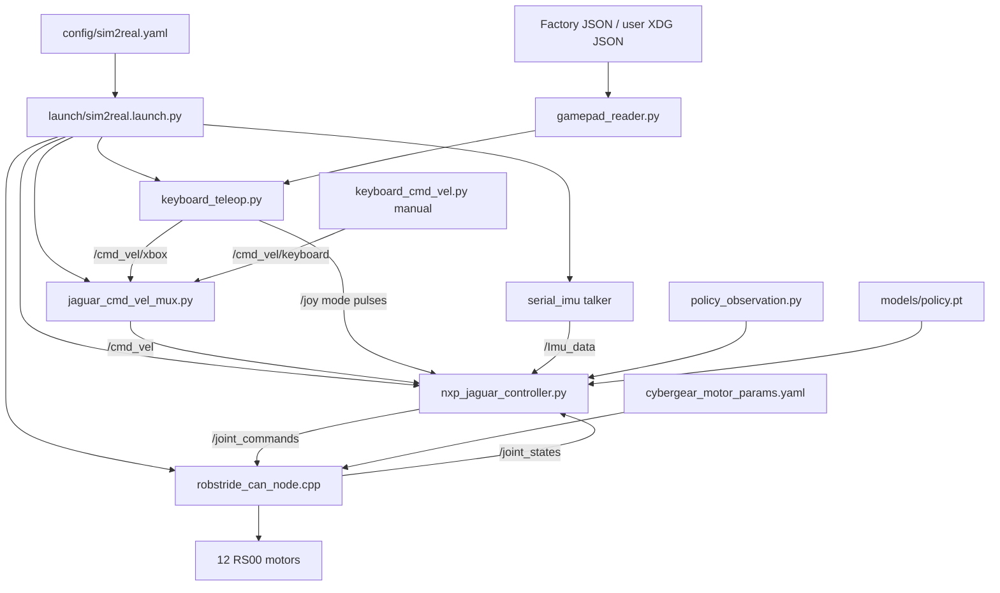

# Repository structure and configuration map

This map describes the ROS 2 deployment repository after the 2026-11-05 cleanup.
The tree includes existing tracked files and new source files; generated build,
install, log, environment and cache directories are excluded.

## Runtime relationships



## Main code and its configuration

| Code | Single responsibility | Configuration / dependency | Connection |
| --- | --- | --- | --- |
| `launch/sim2real.launch.py` | Assemble runtime nodes and ROS overrides | `config_file`, `policy_path`, launch switches | Passes YAML to controller, hardware, Xbox, mux and optional joy node |
| `scripts/nxp_jaguar_controller.py` | State orchestration, safety checks and motor targets | `nxp_jaguar_controller` and `/**` blocks in `sim2real.yaml`; policy path | Sensors/velocity in, `/joint_commands` out |
| `scripts/policy_observation.py` | 45-D scaling and 5-frame history | Training scales fixed in module; controller injects nominal pose | Returns policy input; no ROS/CAN dependency |
| `scripts/joint_layout.py` | Joint names, aliases and order permutations | Fixed ROS leg order and Isaac joint-group order | Shared by controller, Python driver and telemetry tools |
| `scripts/parameters.py` | Python hardware map, calibration and nominal poses | Explicit motor IDs/directions/offsets; gain/rate defaults read from `sim2real.yaml` | Used by fallback driver, controller defaults and manual tools |
| `scripts/motion_limits.py` | Declare/validate body-command bounds | `/**` block in `sim2real.yaml`, then ROS parameter overrides | Shared by controller, Xbox, keyboard and mux |
| `scripts/project_paths.py` | Resolve source, installed and user assets | Package share via ament; XDG config directory | Shared asset lookup, without duplicated workspace paths |
| `scripts/keyboard_teleop.py` | Normalize Xbox/local/remote input and mode pulses | Shared motion limits and `jaguar_unified_teleop` base/boost speeds; `keyboard_enabled:=false` in normal launch | `/cmd_vel/xbox` and `/joy` |
| `scripts/gamepad_reader.py` | Read and normalize Linux joystick input | User calibration first, factory `config/gamepad_calibration.json` second | Imported by Xbox and calibration tools |
| `scripts/calibrate_xbox.py` | Measure and save controller calibration | Writes `${XDG_CONFIG_HOME:-~/.config}/jaguar_control/gamepad_calibration.json` | Reader uses saved profile after restart |
| `scripts/jaguar_cmd_vel_mux.py` | Choose fresh source and limit Xbox acceleration | Shared limits and `jaguar_cmd_vel_mux` timeouts in `sim2real.yaml` | Xbox priority, keyboard fallback, otherwise zero |
| `scripts/keyboard_cmd_vel.py` | Held-key velocity source and release handling | Shared limits; node parameters/keyboard keys | Manual `/cmd_vel/keyboard` source |
| `src/robstride_can_node.cpp` | ROS/real-time CAN bridge | `robstride_can_hardware` block in `sim2real.yaml`, `motor_params_file` | 200 Hz CAN target loop and feedback publication |
| `include/jaguar_control/robstride_hardware_manager.hpp` | Joint mapping, dispatch and hardware watchdogs | Explicit C++ `JointConfig` entries and limits | Uses bus/protocol helpers; offset convention checked against Python |
| `include/jaguar_control/robstride_can_bus.hpp` | SocketCAN transport | Bus names from manager | Linux non-blocking CAN I/O |
| `include/jaguar_control/robstride_protocol.hpp` and `include/cybergear_driver_core/` | CAN frame encoding/decoding | RS00 ranges loaded from `config/cybergear_motor_params.yaml` | Protocol implementation used by C++ driver/tests |
| `include/jaguar_control/cybergear_motor_config.hpp` | Parse/validate RS00 encoding configuration | `config/cybergear_motor_params.yaml` | Supplies protocol ranges before buses open |
| `scripts/can_hardware_node.py` | Optional Python hardware fallback | `jaguar_can_hardware` block plus `parameters.py` | Selected with `use_cpp_hardware:=false` |
| `scripts/robstride_motor_lib.py` | Python RS motor communication | Explicit construction arguments from callers | Used by fallback and manual motor tools |
| `serial_imu/src/serial_port.cpp` and `ch_serial.c` | Serial acquisition and IMU packet parsing | ROS `port`, `frame_id`, `topic_name`; standalone IMU launch arguments | Publishes IMU measurements; parser tested without serial hardware |
| `launch/display.launch.py` | Assemble robot display | `model`, `rviz_config`; defaults to `urdf/nxp_jaguar.urdf` and `config/jaguar_display.rviz` | Reads actual model override, resolves meshes through package URIs |
| `scripts/pace/` | Collection, conversion, fitting and validation tools | CLI inputs, external Isaac Lab/PACE workspaces | Offline workflow; chirp requires explicit arming |
| `scripts/export_*_policy.py` | Export training models | Explicit checkpoint path, optional output/tag/raw policy | Source-only tools; default model replacement requires `--set-default` |

## Configuration precedence

1. Launch `config_file` is passed to participating ROS nodes; ROS overrides
   applied after a file win (for example `torque_safety_enabled`).
2. `motion_limits.py` declares packaged YAML defaults; node-specific ROS
   overrides still take precedence.
3. Standalone calibration/hardware helpers obtain default gains/rate from the
   packaged YAML through `parameters.py`. They do not consume another node's
   `config_file` automatically.
4. Policy observation scales, action scale and training reference are model
   contracts in code; they are not free tuning knobs in the runtime YAML.
5. C++ and Python motor calibration maps remain explicit in their languages.
   Their angle-offset conventions have opposite signs. A regression test checks
   all 12 names, buses, IDs, directions and offsets across implementations.

## Clean-code changes

- Removed the ROS 1 controller dependency chain, ROS 1 launches/transforms,
  unused message definition, duplicate runtime YAMLs, incomplete simulator
  entry point, old backup script, old models and duplicate mesh/URDF copies.
- Retained the active policy, its identical named identity export, matching source checkpoint,
  deployment manifest, training snapshots and recorded experiment data.
- Extracted observation/history into a ROS-independent module. Controller
  methods now separate parameter setup, policy verification, trajectory
  interpolation, WALK inference, command publication and timing diagnostics.
- Centralized Python joint-order definitions and source/install asset lookup.
- Installed runtime scripts separately from importable modules. Added missing
  manual diagnostics/calibration entry points and installed factory calibration.
- Runtime installation includes the default policy, its named identity export and deployment manifest,
  avoiding training checkpoints in the installed package.
- Registered Python, CAN, motion-safety and C serial-parser tests with CTest.
  Native assertion tests remain enabled in optimized builds.
- Fixed display model overrides, updated RViz plugin names for ROS 2, and used
  one canonical URDF with package-resolved mesh references. Unused Gazebo/ros2_control blocks with external hardcoded paths were removed from the display URDF.

The cleanup removed 135 old files (including 99 files under `models/`, 12
configuration files, 10 launch files, eight scripts/backups, four unused foot-pad meshes and two message files).
The named actor export is retained beside `models/policy.pt` as its identity
pair. The manifest records `policy_file` and `identity_policy_file`, and a
regression test requires both files to match the pinned policy SHA-256.
The moved calibration profile and canonical URDF are retained at their new
paths. A local recovery copy and the pre-cleanup working diff are in
`/tmp/sim2real-cleanup-backup-20261105/`; this temporary directory is not a
permanent archive. Git history retains committed versions.

## Full source tree

```text
sim2real/
├── .gitignore
├── CMakeLists.txt
├── LICENSE
├── README.md
├── benchmark_data/
│   ├── benchmark_sim2real_20260916_192458.npz
│   ├── benchmark_sim2real_20260916_192609.npz
│   ├── benchmark_sim2real_20260916_195342.npz
│   ├── benchmark_sim2real_20260916_200015.npz
│   ├── benchmark_sim2real_20260916_200809.npz
│   ├── benchmark_sim2real_20260917_161402.npz
│   └── benchmark_sim2real_20260917_162153.npz
├── bin/
│   ├── README.md
│   └── can_setup.sh
├── config/
│   ├── 99-usb-can.rules
│   ├── README.md
│   ├── cybergear_motor_params.yaml
│   ├── gamepad_calibration.json
│   ├── jaguar_display.rviz
│   └── sim2real.yaml
├── data/
│   └── pace/
│       ├── jaguar_chirp_20261012_145729/
│       │   ├── jaguar_chirp_20261012_145729_0.db3
│       │   └── metadata.yaml
│       └── jaguar_chirp_commands_20261012_145733.csv
├── docs/
│   ├── cybergear_driver_and_imu.md
│   ├── pace_calibration_validation.md
│   ├── pace_pc_training_notes.md
│   ├── pace_system_identification.md
│   ├── repository_structure.md
│   ├── training_notes.md
│   └── upgrade_jazzy.md
├── imgs/
│   └── design.jpg
├── include/
│   ├── cybergear_driver_core/
│   │   ├── bounded_float_byte_converter.hpp
│   │   ├── cybergear_frame_id.hpp
│   │   ├── cybergear_packet.hpp
│   │   ├── cybergear_packet_param.hpp
│   │   ├── protocol_constant.hpp
│   │   └── scaled_float_byte_converter.hpp
│   └── jaguar_control/
│       ├── README.md
│       ├── cybergear_motor_config.hpp
│       ├── robstride_can_bus.hpp
│       ├── robstride_hardware_manager.hpp
│       └── robstride_protocol.hpp
├── launch/
│   ├── README.md
│   ├── display.launch.py
│   ├── robstride_standalone.launch.py
│   └── sim2real.launch.py
├── meshes/
│   ├── Base_body.STL
│   ├── Bl_coxa_roll.STL
│   ├── Bl_hip_pitch.STL
│   ├── Bl_tibia_pitch.STL
│   ├── Br_coxa_roll.STL
│   ├── Br_hip_pitch.STL
│   ├── Br_tibia_pitch.STL
│   ├── Fl_coxa_roll.STL
│   ├── Fl_hip_pitch.STL
│   ├── Fl_tibia_pitch.STL
│   ├── Fr_coxa_roll.STL
│   ├── Fr_hip_pitch.STL
│   ├── Fr_tibia_pitch.STL
│   ├── README.md
│   └── inertia.txt
├── models/
│   ├── adaboot_ideal_l2c2_kp45kd45_clear8cm_29996_20261022/
│   │   ├── agent.yaml
│   │   └── env.yaml
│   ├── deployment_adaboot_ideal_l2c2_kp45kd45_clear8cm_29996_20261022.json
│   ├── model_adaboot_ideal_l2c2_kp45kd45_clear8cm_29996_20261022.pt
│   ├── policy.pt
│   └── policy_adaboot_ideal_l2c2_kp45kd45_clear8cm_29996_20261022.pt
├── package.xml
├── scripts/
│   ├── README.md
│   ├── bringup_canbus.sh
│   ├── bringup_imu.sh
│   ├── build.sh
│   ├── calibrate_parallel_link.py
│   ├── calibrate_sit_zero.py
│   ├── calibrate_stand_pose.py
│   ├── calibrate_xbox.py
│   ├── can_hardware_node.py
│   ├── check_joints.py
│   ├── check_states.py
│   ├── export_adaboot_policy.py
│   ├── export_adaptive_policy.py
│   ├── gamepad_reader.py
│   ├── jaguar_cmd_vel_mux.py
│   ├── joint_layout.py
│   ├── keyboard_cmd_vel.py
│   ├── keyboard_teleop.py
│   ├── monitor_joints.py
│   ├── motion_limits.py
│   ├── nxp_jaguar_controller.py
│   ├── pace/
│   │   ├── analyze_pace_replay.py
│   │   ├── convert_rosbag_to_pace.py
│   │   ├── create_pace_default_candidate.py
│   │   ├── record_jaguar_joint_data.sh
│   │   ├── run_jaguar_chirp.py
│   │   └── run_jaguar_pace_calibration.py
│   ├── parallel_link_mapping.py
│   ├── parameters.py
│   ├── plot_torques.sh
│   ├── policy_observation.py
│   ├── project_paths.py
│   ├── record_sim2real_benchmark.py
│   ├── remote_xbox_forwarder.py
│   ├── robstride_motor_lib.py
│   ├── robstride_motor_test.py
│   ├── scan_robostride_ids.py
│   ├── set_robostride_zero.py
│   ├── source_ros.sh
│   ├── stop_all.sh
│   ├── test_sit_stand.py
│   └── wifi_switch.sh
├── serial_imu/
│   ├── CMakeLists.txt
│   ├── README.md
│   ├── launch/
│   │   └── imu_spec_msg.launch.py
│   ├── package.xml
│   └── src/
│       ├── ch_serial.c
│       ├── ch_serial.h
│       ├── serial_port.cpp
│       └── sub_spec.cpp
├── src/
│   ├── README.md
│   └── robstride_can_node.cpp
├── tests/
│   ├── test_can_protocol.cpp
│   ├── test_cmd_vel_ramp.py
│   ├── test_controller_safety.py
│   ├── test_controller_targets.py
│   ├── test_deployment_contract.py
│   ├── test_imu_standing_stabilization.py
│   ├── test_launch_domain.py
│   ├── test_motion_limits.py
│   ├── test_motion_safety.cpp
│   ├── test_motor_safety.py
│   ├── test_pace_calibration_workflow.py
│   ├── test_parallel_link_mapping.py
│   ├── test_policy_observation.py
│   ├── test_project_assets.py
│   ├── test_serial_parser.c
│   └── test_xbox_controls.py
└── urdf/
    ├── README.md
    └── nxp_jaguar.urdf
```
